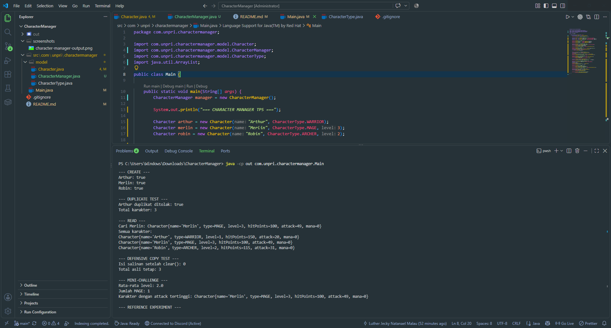

# Character Manager — TP3 (Java Visual SIH-6406)

# Deskripsi
Character Manager adalah project Java yang menerapkan konsep class, object, constructor, encapsulation, dan enum. Project ini dikembangkan dengan menambahkan atribut mana, validasi nilai mana, method isAlive(), serta demonstrasi level up karakter.

# Fitur yang digunakan
- Empat tipe karakter menggunakan enum
- Dua constructor pada class Character
- Getter dan setter untuk atribut karakter
- Level up yang meningkatkan hit points dan attack
- Validasi agar mana tidak bernilai negatif
- Method isAlive() untuk memeriksa apakah karakter masih hidup
- toString() untuk menampilkan informasi karakter

# Screenshot


# Struktur Folder
```
CharacterManager/
├── src/
│   └── com/
│       └── unpri/
│           └── charactermanager/
│               ├── Main.java
│               └── model/
│                   ├── Character.java
│                   └── CharacterType.java
├── out/
├── screenshots/
│   └── character-manager-output.png
├── README.md
└── .gitignore
```

- Nama: Luther Jecky Natanael Malau
- NIM: 263316621261
- Google Docs Analisis: https://docs.google.com/document/d/1E0JfsgATnNYDeVj7zkCt0OgDjtFt66PZzHQIvI_jKow/edit?usp=sharing


# TP5 — Character Manager Sprint #2

## Fitur yang Diimplementasikan

- `equals()` membandingkan nama karakter tanpa membedakan huruf besar dan kecil.
- `CharacterManager` mendukung add, find, remove, dan penghitungan karakter.
- `getAllCharacters()` mengembalikan salinan daftar.
- `getAverageLevel()` mengembalikan 0.0 ketika daftar kosong.
- `findByType()` mencari karakter berdasarkan tipe.
- `findStrongest()` mencari karakter dengan nilai attack tertinggi.
- `totalCharacterCreated` menghitung objek yang dibuat menggunakan atribut static.

## Hasil Pengujian

- Nama duplikat ditolak.
- Menghapus isi salinan daftar tidak mengubah jumlah karakter pada daftar asli.
- Rata-rata level tiga karakter adalah 2.0.
- Karakter dengan attack tertinggi adalah Merlin dengan attack 49.
- Eksperimen reference menghasilkan `a.getLevel() = 8` dan `a == b = true`.
- Rata-rata pada daftar kosong menghasilkan `0.0`.

## Fitur Mandiri: findStrongest()

Method `findStrongest()` mencari karakter dengan nilai attack tertinggi di dalam daftar. Method ini tidak mengembalikan daftar internal, dan mengembalikan `null` jika belum ada karakter. Fitur ini berguna untuk mengetahui karakter dengan serangan paling tinggi tanpa mengubah koleksi yang dikelola oleh CharacterManager.

## Screenshot Output



## Analisis Google Docs

[JavaVisual_TP05 — Analisis Reference dan Rancangan]()
