# Character Manager — TP3 & TP5 & TP8
Mata Kuliah: Java Visual

**Nama:** Luther Jecky Natanael Malau  
**NIM:** 263316621261

## Screenshot TP3

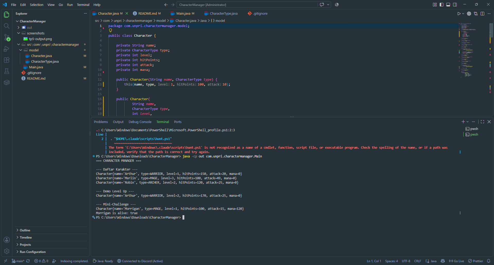

## Analisis Google Docs

[Document Analysis TP3](https://docs.google.com/document/d/1E0JfsgATnNYDeVj7zkCt0OgDjtFt66PZzHQIvI_jKow/edit?usp=sharing)

## Screenshot TP5

### 1. CRUD dan Penolakan Duplikat
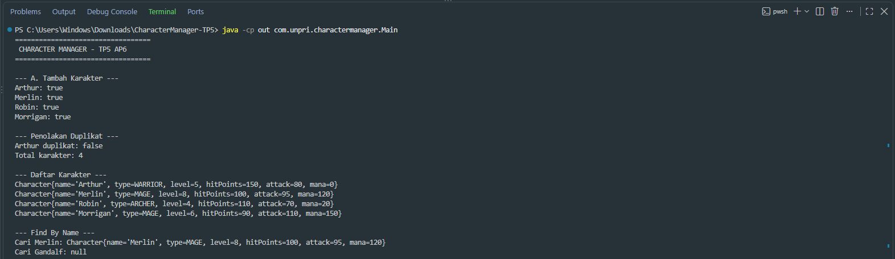

### 2. Analytics dan Find Strongest
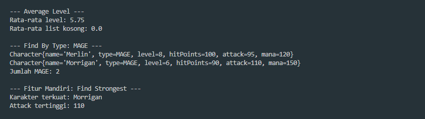

### 3. Object Reference
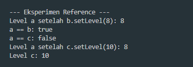

### 4. Defensive Copy
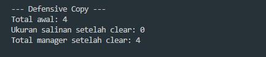

## Analisis Google Docs

[Document Analysis TP5](https://docs.google.com/document/d/1laqV9ykuvLZrTRzMNo4mBxcClv7DFGbQ91m7KJjdqmo/edit?usp=sharing)

## TP8 — Character Manager Sprint #3: MainWindow, Data Dinamis & Analisis MVC

### Bukti Screenshot

**Sebelum perubahan — rata-rata level 5.50**

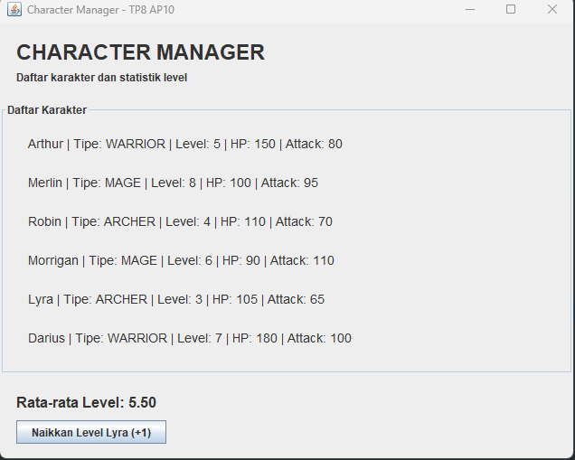

**Sesudah perubahan — rata-rata level 5.67**

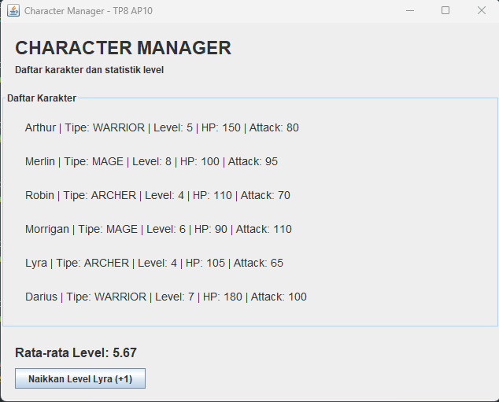

## Analisis Google Docs

[Document Analysis TP8](https://docs.google.com/document/d/1YuUuwlcIKhMpSbZ3j4L91MaFQ3YWwNlvuurS1qPc3D0/edit?usp=sharing)

### Karakter Baru
- **Lyra** — ARCHER, level 3. Karakter ini ditambahkan untuk menguji perubahan level dan pembaruan statistik secara langsung.
- **Darius** — WARRIOR, level 7. Karakter ini menambah variasi level dan tipe karakter untuk menguji tampilan data dinamis.

---

## TP10 — Java Visual: Character Manager, Centralized Theme & UI Enhancement

### Bukti Screenshot

**Tampilan Character Manager TP10**

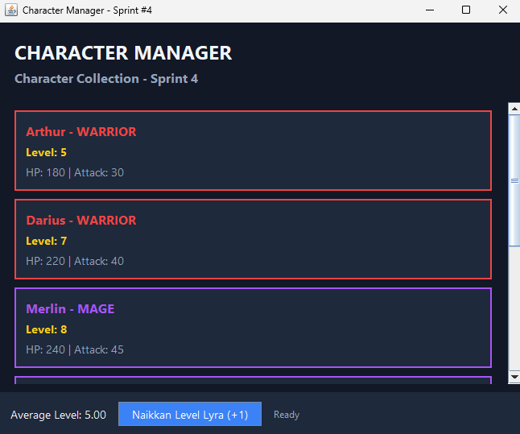

## Analisis Google Docs

[Document Analysis TP10](https://docs.google.com/document/d/1hHdFJI4NjPCaT02qOoBFvs0IjoFJrd-qH5YzpBouclM/edit?usp=sharing)

---

## TP12 — Java Visual: Character Manager, Layout, UI Responsif & Analisis MVC

### Bukti Screenshot

**1. Tampilan Normal**

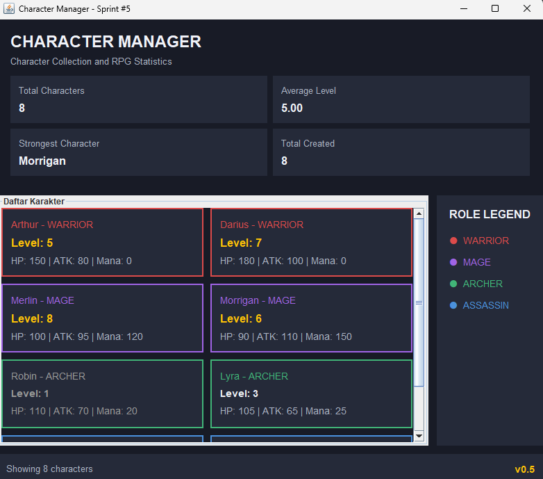

**2. Tampilan Maksimal**

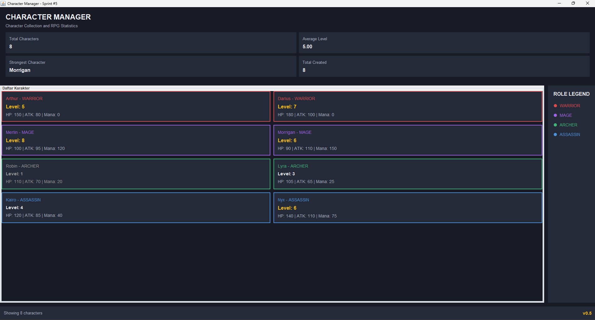

**3. Tampilan Minimum**

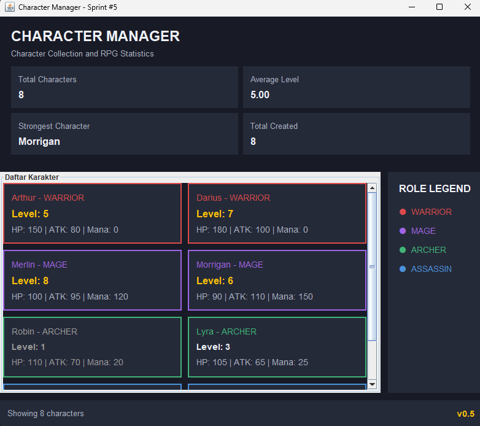

## Analisis Google Docs

[Document Analysis TP12](https://docs.google.com/document/d/1vlfgznhgaWmkDvOHN0iz5vWzFeyNl7hTCXjZq8SDJwg/edit?usp=sharing)

