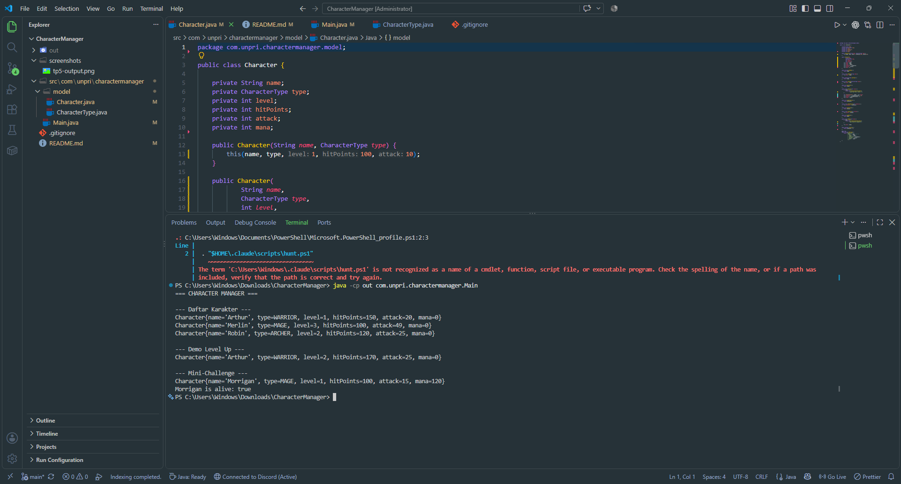
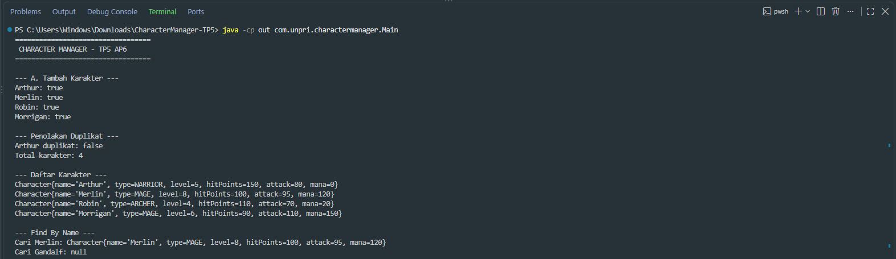
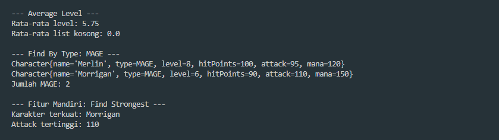
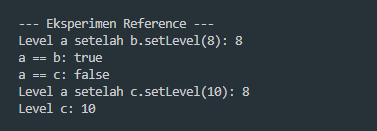
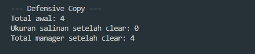
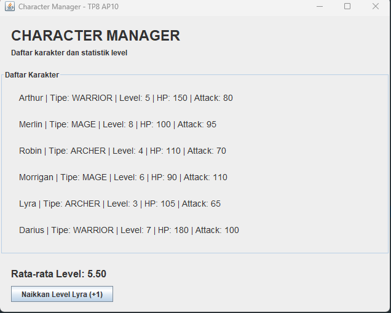
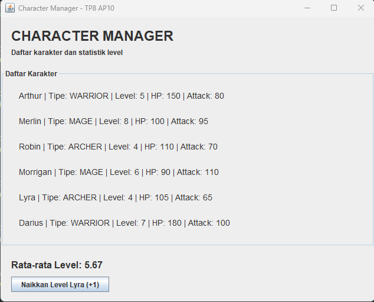

# Character Manager — TP3 & TP5 & TP8
Mata Kuliah: Java Visual

**Nama:** Luther Jecky Natanael Malau  
**NIM:** 263316621261

## Deskripsi

Character Manager adalah project Java yang dikembangkan secara bertahap untuk mempraktikkan class, object, constructor, encapsulation, enum, object reference, dan pengelolaan kumpulan objek.

Pada TP3, project mencakup atribut karakter, validasi mana, `isAlive()`, dan level up. Pada TP5, project dikembangkan dengan fitur pengelolaan karakter menggunakan `CharacterManager`.

## Fitur TP3

- Empat tipe karakter menggunakan enum
- Constructor, getter, dan setter
- Validasi nilai mana agar tidak negatif
- `isAlive()` untuk memeriksa kondisi karakter
- Level up yang meningkatkan hit points dan attack
- `toString()` untuk menampilkan informasi karakter

## Fitur TP5

- `addCharacter()` untuk menambah karakter dan menolak nama duplikat
- `findByName()` untuk mencari karakter berdasarkan nama
- `removeCharacter()` untuk menghapus karakter
- `getTotalCharacters()` untuk menghitung jumlah karakter
- `getAllCharacters()` untuk memberikan salinan daftar karakter
- `getAverageLevel()` untuk menghitung rata-rata level, termasuk saat daftar kosong
- `findByType()` untuk mencari karakter berdasarkan tipe
- `findStrongest()` sebagai fitur tambahan untuk mencari karakter dengan attack tertinggi
- `equals()` untuk membandingkan karakter berdasarkan nama
- Eksperimen object reference dan static counter

## Screenshot TP3

## Analisis Google Docs

[Document Analysis TP3](https://docs.google.com/document/d/1E0JfsgATnNYDeVj7zkCt0OgDjtFt66PZzHQIvI_jKow/edit?usp=sharing)

## Screenshot TP5

### 1. CRUD dan Penolakan Duplikat

### 2. Analytics dan Find Strongest

### 3. Object Reference

### 4. Defensive Copy

## Analisis Google Docs

[Document Analysis TP5](https://docs.google.com/document/d/1laqV9ykuvLZrTRzMNo4mBxcClv7DFGbQ91m7KJjdqmo/edit?usp=sharing)

## TP8 — Character Manager Sprint #3: MainWindow, Data Dinamis & Analisis MVC

### Implementasi
TP8 mengembangkan Character Manager dari program berbasis console menjadi aplikasi GUI menggunakan Java Swing. Tampilan utama dibuat dalam kelas `MainWindow` yang mewarisi `JFrame`. Data karakter diambil melalui `CharacterManager` dan ditampilkan secara dinamis menggunakan perulangan, sehingga daftar tidak perlu ditulis satu per satu secara manual.

Aplikasi menampilkan enam karakter: Arthur, Merlin, Robin, Morrigan, Lyra, dan Darius. Statistik rata-rata level dihitung menggunakan `CharacterManager.getAverageLevel()` dan ditampilkan melalui `JLabel`. Tombol **Naikkan Level Lyra (+1)** digunakan untuk mengubah level Lyra dan memperbarui daftar serta statistik pada tampilan.

### Bukti Screenshot

**Sebelum perubahan — rata-rata level 5.50**

**Sesudah perubahan — rata-rata level 5.67**

## Analisis Google Docs

[Document Analysis TP8](https://docs.google.com/document/d/1YuUuwlcIKhMpSbZ3j4L91MaFQ3YWwNlvuurS1qPc3D0/edit?usp=sharing)

### Data Flow dan MVC
Alur aplikasi dimulai dari `Main`, yang membuat objek `CharacterManager` dan mengisi data karakter. `CharacterManager` mengelola koleksi karakter serta menyediakan operasi pencarian dan perhitungan rata-rata level. Objek `MainWindow` menerima `CharacterManager`, mengambil data karakter, kemudian menampilkan daftar dan statistik melalui komponen Swing. Pemisahan ini memisahkan pengelolaan data dari tampilan, meskipun penanganan tombol pada implementasi ini masih berada di kelas View dan dapat dipisahkan lebih lanjut ke Controller untuk penerapan MVC yang lebih ketat.

### Karakter Baru
- **Lyra** — ARCHER, level 3. Karakter ini ditambahkan untuk menguji perubahan level dan pembaruan statistik secara langsung.
- **Darius** — WARRIOR, level 7. Karakter ini menambah variasi level dan tipe karakter untuk menguji tampilan data dinamis.

